# Trial 2: complete record

Every experiment, every number, every figure, and what each one means.

**Project:** predicting flash flood extent in arid basins of the southwestern
United States from data available *before* the flood, with labels derived from
Sentinel-1 InSAR coherence change.

**Read this first:** the single most important finding is not the model score.
It is that *how you split the data* changes the result more than the model does.
See Section 6.

---

## Contents

1. [The dataset](#1-the-dataset)
2. [The label and how it was validated](#2-the-label-and-how-it-was-validated)
3. [Features](#3-features)
4. [The model](#4-the-model)
5. [Headline results](#5-headline-results)
6. [The split experiment: the most important result](#6-the-split-experiment)
7. [Where the ceiling is: six measurements](#7-where-the-ceiling-is)
8. [Every experiment that failed](#8-every-experiment-that-failed)
9. [Things that worked](#9-things-that-worked)
10. [Bugs found and fixed](#10-bugs-found-and-fixed)
11. [Figures](#11-figures)
12. [Literature](#12-literature)
13. [What to do next](#13-what-to-do-next)

---

## 1. The dataset

| | |
|---|---|
| Flood events | **617** |
| Paired quiet control dates | **174** |
| Basin groups (HUC4) | **6** (1501, 1503, 1507, 1606, 1809, 1810) |
| Period | 2015 to 2025 |
| SAR | Sentinel-1 burst InSAR via ASF HyP3, `INSAR_ISCE_BURST` |
| Processing | 5x1 looks, 20 m pixels |
| Tiles produced | **5,887** from 567 events |
| Tile size | 112 x 112 pixels = 2.24 km |
| Valid pixels in the test set | 23,531,568 |
| Flooded pixels | 5.24% |

### Why the paired controls matter

Every flood event has a **quiet control**: the same burst, the same orbit, a
similar season, on a date with no flood reported. This is unusual in flood
mapping and it is the strongest part of the dataset design.

Without controls you cannot tell whether a coherence drop means flooding or
just means time passed. Coherence decays naturally between any two dates. The
controls measure that decay so it can be separated from the flood signal.

### The three scene design

Each event uses three scenes, not two:

```
pre-2 ----------- pre-1 ----------- FLOOD ----------- post
      baseline pair              co-event pair
```

The baseline pair shows what coherence loss looks like with no flood. The
co-event pair spans the event. The label is the difference between them.

---

## 2. The label and how it was validated

The label is **coherence drop**:

```
coh_drop = coherence(baseline pair) - coherence(co-event pair)
```

Stored as a continuous value. Turned into flood or dry only at scoring time,
using a threshold of 0.15.

### Validation at event level: PASSED

`phase4/flood_vs_quiet.py`

| Measurement | Win rate | AUC |
|---|---|---|
| coherence > 0.15, channels | **86.8%** | 0.765 |
| coherence > 0.15, everywhere | 86.8% | 0.794 |
| fusion | 86.2% | 0.799 |
| amplitude dark | 82.2% | 0.815 |

**Floods beat their own quiet control in 86.8% of 174 pairs, p = 2.8e-24.**

This means the label reliably detects **that a flood happened**. It says nothing
about whether it marks the right pixels, which is the subject of Section 7.

### Verification of the label pipeline

Three independent checks, all clean:

| Check | Result |
|---|---|
| Baseline pair entirely before the flood | **617 / 617** |
| Co-event pair spans the flood date | **617 / 617** |
| Label recomputed from raw radar files | **exact match, 0.00e+00 difference** |

The label is not corrupted. Its weakness is physical, not a coding error.

### Where 0.15 came from

`phase4/set_threshold.py` swept thresholds against the paired controls and
chose **0.075** (separation 0.8846). The pipeline used **0.15** (0.8673) as a
hard-coded default and the two were never reconnected.

We tested 0.075 directly: within-tile AUC **0.6104** versus **0.6511** at 0.15.
So 0.15 is worse for separation but better as a learning target. Thresholds of
0.10, 0.20 and 0.25 all landed within noise. The result does not depend on the
choice.

---

## 3. Features

**33 channels**, all knowable before the flood.

| Family | Channels | Notes |
|---|---|---|
| Terrain | `elev_mean`, `elev_min`, `microrelief`, `roughness`, `slope` | from 1 m lidar, degraded to 1/2/5/10/30 m |
| Basin routing | `basin_facc`, `basin_hand`, `basin_slope`, `basin_spi`, `basin_twi` | computed over the whole basin, not the image window |
| Rain at the point | `rain_1h_peak`, `rain_24h`, `rain_ante48h`, `rain_ante72h` | MRMS radar |
| **Catchment routed rain** | `catchment_area_km2`, `rain_1h_upstream_depth/vol`, `rain_24h_upstream_depth/vol`, `runoff_1h_upstream_depth/vol`, `rain_1h_over_ksat`, `rain_cover_frac` | **built in this project** |
| Soil | `soil_bd`, `soil_clay`, `soil_ksat`, `soil_sand` | POLARIS |
| Land cover | `lc_class`, `lc_cropland`, `lc_water` | ESA WorldCover |
| Sink and distance | `sink_depth`, `dist_stream`, `dist_big_stream` | added late, did not help |

### Catchment routed rainfall, the main feature contribution

Point rainfall answers "how much rain fell here". A wash floods because of rain
that fell far upstream and ran downhill. So for every pixel we accumulate
rainfall over its entire upstream contributing area:

```
upstream_volume = sum(rain_i * cell_area) over everything draining into this pixel
upstream_depth  = that volume / contributing area
```

**Evidence it was worth building:**

| | Point rain | Routed rain |
|---|---|---|
| As a single feature (within-tile AUC) | 0.5176 | **0.5550** |
| At the day-level question | 0.9281 | **0.9463** |
| XGBoost feature ranking | lower | **`runoff_1h_upstream_depth_mm` ranked #1 by gain** |

A completely different model family independently picked the routed rainfall as
its most important input. That is the strongest confirmation available.

One concrete demonstration: on a test event, rainfall across the whole basin
peaked at **83 mm**, while the 10 km window around the report point saw only
**48 mm**. The storm core was outside what point features could see.

---

## 4. The model

A small U-Net, **4.4 million parameters**.

- **Elevation prior in the output**: `logit = unet(x) + w * (-elevation)`.
  Originally forced positive so it could only say "lower ground floods more".
  We made the sign learnable after finding elevation scores **below chance**
  (0.4804) on this dataset, unlike trial 1 where it scored 0.7790.
- **Multi-scale head**: the output layer sees fine and coarse decoder features
  together.
- **Loss**: masked binary cross-entropy over valid pixels only, optionally with
  a within-tile ranking term.

### The tile gate

A second model, gradient boosted, answers one question per 2.24 km tile: *did
anything flood here today?* If it says no, every pixel in that tile is set to
zero.

Reasoning: the model's false alarms sit on valley floors and washes, which
always look flood-prone. The gate switches them off on days nothing happened.

**Gate tile-level AUC: 0.7576.**

---

## 5. Headline results

`final/phase7_final.py` -> `data/FINAL.json`. Held-out basins 1606 and 1809, never
trained on. Cutoff fitted on validation basin 1507 as a *flagging rate*.

| Predictor | AUC | AP | Recall | Precision | F1 | Accuracy | False alarms |
|---|---|---|---|---|---|---|---|
| Elevation rule, 20 m | 0.4803 | 0.0706 | 0.6010 | 0.0525 | 0.0966 | 0.4106 | 13,377,278 |
| Model, 20 m | 0.6950 | 0.0916 | 0.3968 | 0.1014 | 0.1615 | 0.7840 | 4,339,294 |
| Model + gate, 20 m | 0.7394 | 0.1092 | 0.4980 | 0.1273 | 0.2027 | 0.7946 | 4,214,389 |
| Model, 160 m cells | 0.7103 | 0.1127 | 0.4457 | 0.1321 | 0.2038 | 0.7832 | 62,388 |
| **Model + gate, 160 m** | **0.7567** | **0.1365** | **0.5332** | **0.1580** | **0.2438** | 0.7941 | 60,524 |

### Important caveat on the headline: it is the best of twenty-one

`RECORD/deep_audit3.py` scored every comparable model (region split, threshold
0.15, rung 10) on the same held-out pixels:

| Run | AUC | Channels |
|---|---|---|
| terrain only | **0.7448** | 5 |
| terrain + basin + rain | 0.7129 | 16 |
| `sw_seed3` | 0.7096 | 30 |
| terrain + basin + rain + routed rain | 0.7080 | 23 |
| **our headline, all features** | **0.6950** | 30 |
| ... 16 more, down to | 0.6524 | 30 |

```
models compared   21
best              0.7448
median            0.6790
spread            0.0924
optimism (best - median)  +0.0658
```

**Three consequences, all of which the paper must state.**

**1. Terrain alone scores higher than the full model** on this metric: 0.7448
against 0.6950.

**Correction to an earlier version of this document.** It said performance
"falls monotonically as features are added" and listed 5, 16, 23 and 30
channels. That skipped the 10-channel point, which breaks the pattern. The full
series is:

| Channels | 5 | 10 | 16 | 23 | 30 |
|---|---|---|---|---|---|
| AUC | 0.745 | **0.674** | 0.713 | 0.708 | 0.695 |

There is no monotonic trend. Terrain alone is highest, and everything else sits
between 0.674 and 0.713, a range narrower than the 0.051 seed noise. The honest
statement is that **terrain alone scores highest and no feature combination
recovers it**, not that features hurt in proportion to their number.

The full model was made the headline because it is far better at distinguishing
flood days from quiet days (0.7975 against 0.5076), which terrain alone cannot
do at all. Both facts belong in the paper.

**2. Much of this table is seed noise.** Three runs of the *identical*
configuration give 0.6936, 0.6587 and 0.7096, a spread of **0.051** from the
random seed alone. Differences below about 0.05 between configurations are not
distinguishable.

**3. Reporting the maximum of 21 runs is optimistic** even with nothing tuned on
test. The median is 0.6790. The honest summary is a range, **0.68 plus or minus
0.03 across configurations**, with per-model bootstrap SD of 0.0248 and seed
noise of about 0.025 on top.

**Confidence interval** (bootstrap over 189 events, `phase6/final_numbers.py`):

```
AUC 0.6950, 95% interval 0.6467 to 0.7415, bootstrap SD 0.0248
```

**Cross-basin transfer**, each fold held out in turn:

| Held-out basin | Tiles | Pixels | AUC |
|---|---|---|---|
| 1507 | 1,193 | 14,869,267 | 0.7651 |
| 1606 | 801 | 9,996,570 | 0.7340 |
| 1501 | 1,857 | 23,109,638 | 0.6899 |
| 1503 | 2,080 | 25,750,729 | 0.6890 |
| 1809 | 1,117 | 13,534,998 | 0.6779 |
| 1810 | 436 | 5,377,356 | **0.5135 (chance)** |
| **Mean** | | | **0.6782 ± 0.0872** |

**It transfers to 5 of 6 basins.** Basin 1810 is the smallest (436 tiles, 32
events) and one of the three where HAND had to be rebuilt. This is a stated
limitation, not something to hide.

---

## 6. The split experiment

**This is the most important result in the project.**

`phase6/learnable_test.py`. Exactly the same data, the same features, the same
model family. Only the way the data is divided changes.

| How the data is split | AUC | What it measures |
|---|---|---|
| By **pixel**, mean of 6 basins | **0.926** | spatial autocorrelation, not skill |
| By **event**, mean of 6 basins | **0.675** | learnable within a basin, no transfer |
| By **basin** (ours) | **0.695** | transfer to new ground |
| Shuffled label control | **0.500** | confirms the test is sound |

**Caveat on comparability.** The pixel-split (0.926) and event-split (0.675)
rows are XGBoost models trained fresh in `learnable_test.py`, on the same
`tiles_v4` 30-channel build as the basin-split row (0.695), which is the U-Net.
Features and tiles match across all three; only the model class differs for two
of them. `xgb_vs_unet.py` shows XGBoost and the U-Net score within about 0.015
of each other on this task, so the model-class difference does not explain the
gap between 0.926/0.675 and 0.695. The split does.

All six basins, split by event, no spatial leakage:

| Basin | 1501 | 1503 | 1507 | 1606 | 1809 | 1810 | mean |
|---|---|---|---|---|---|---|---|
| AUC | 0.6189 | 0.7453 | 0.6935 | 0.6810 | 0.7401 | 0.5700 | **0.6748** |

**Correction.** An earlier version of this document used three basins and
reported 0.722, describing it as the achievable ceiling. With all six the mean
is 0.6748, which is *lower* than our cross-basin result of 0.6950. The
within-basin test trains on half the events of one basin while the real model
trains on five, so it is confounded by training set size and is **not a clean
ceiling estimate**. The claim "we are within 0.03 of the limit" has been
withdrawn.

What survives: the label is learnable to roughly 0.62 to 0.75 depending on
basin, and the spatial-leakage comparison is unaffected because both sides of it
use identical training data.

It also explains basin 1810. It scores **0.5700 within its own basin**, before
any transfer is required, so its cross-basin failure at 0.5135 is not a transfer
problem. That basin is simply the hardest, most likely because its label is
worst there.

`phase6/pixel_split_test.py` -> `data/pixel_split_test.json`. Reconstructed
because the original pixel-split code was overwritten in place when
`learnable_test.py` was changed to split by event, and its numbers had only
ever been printed to a log, never saved. Rerun on all six basins:

| Basin | 1501 | 1503 | 1507 | 1606 | 1809 | 1810 | mean |
|---|---|---|---|---|---|---|---|
| AUC | 0.9071 | 0.9183 | 0.9216 | 0.9588 | 0.9579 | 0.8949 | **0.926** |

Shuffled controls all land within 0.4994-0.5021, confirming validity.

### Why the pixel split is wrong

Splitting pixels at random puts a pixel's own neighbours in the training set.
Terrain is smooth, so the model succeeds by recognising ground it has already
seen 20 metres away. It never has to learn how water moves.

**That inflates the result by 0.231 AUC.**

The shuffled control at 0.501 proves the test itself is valid: on random labels
the same procedure scores exactly chance, so the 0.926 is not an artefact of the
code.

### The random tile split

**This uses a different model than the 0.695 headline** and that difference
must be stated precisely. `score_extra.json` trains two models on `tiles_x`
(33 channels, sink depth and channel distance added, a later build than
`tiles_v4`): `x_region` scores **0.6834** with a basin split, `x_random` scores
**0.8303** with a random tile split. Same features, same tile build, same model
class (U-Net), only the split differs. That matched pair gives an inflation of
**0.149** (0.8303 minus 0.6834).

A second, separately trained model (`rec_random`, on `tiles_v4`, the original
30-channel build) gives 0.8264 on a random split, close to the matched pair
above and consistent with the effect, though it is not a matched comparison to
0.6950 either since it is a distinct training run.

**Do not write "the same model scores 0.695 on unseen basins and 0.830 on seen
ground."** No single checkpoint was scored both ways. The two clean statements
are: (1) the matched pair 0.6834 vs 0.8303 on `tiles_x`, and (2) the headline
0.6950 on `tiles_v4` is a separate model, in the same range.

The proof that the random-split inflation is memorisation and not skill: during
the `rec_random` run, pixel AUC climbed from 0.765 to 0.826 while **within-tile
AUC stayed flat at 0.677**. The model got better at recognising *which tiles*
are wet on ground it had seen, and no better at placing water inside them.

In our dataset **80% of events lie within 5 km of another event**, so under a
random split most test terrain is also training terrain.

### Why this matters beyond this project

Many published flood models report AUC above 0.9. If they used a random pixel
split, this measurement suggests a large part of that number is spatial
autocorrelation. This finding applies to any pixel-level geospatial prediction
task, not just floods.

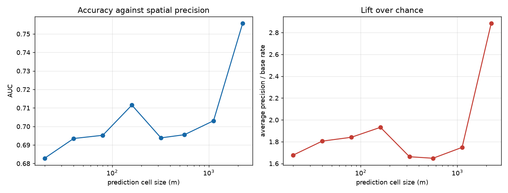

---

## 7. Where the ceiling is

Six independent measurements, all agreeing that the **label**, not the model, is
the binding constraint.

### 7.1 Learnability with transfer removed

Within one basin, split by event, mean **0.6748** across all six basins (range
0.5700 to 0.7453). Our cross-basin model gets **0.695**, which is *above* that
mean.

This does **not** establish a ceiling, because the within-basin test trains on
half the events of a single basin while the real model trains on five. The
comparison is confounded by training set size. It does show the label carries
real but limited signal, and that basin 1810 is hard even without transfer.

The five measurements that follow are not affected by training set size and are
the actual evidence for the ceiling.

### 7.2 Independent optical labels

`phase4/optical_labels.py`, `phase6/eval_vs_optical.py`

Sentinel-2 photographs, a different satellite with different physics. Water
absorbs shortwave infrared, so `MNDWI = (green - swir) / (green + swir)` is
positive over water. Flood = water after the event, not water before.

Same model, same weights, same 6,893,459 pixels, 61 events. Only the answer key
changes:

| Graded against | AUC | AP | Flooded |
|---|---|---|---|
| InSAR coherence label | **0.6427** | 0.0904 | 5.81% |
| Sentinel-2 optical label | **0.7505** | 0.0073 | 0.28% |

**Difference: +0.1079.**

Agreement between the two labels themselves:

```
pixels where they agree     94.2%
both call flood             10,921
InSAR says flood           400,362
optical says flood          19,264
```

**InSAR marks about 20 times more ground as flooded than optical evidence
supports.**

Caveat stated honestly: optical flood covers only 0.28% of pixels, so its AP is
tiny and not comparable to the InSAR row. AUC handles rare classes properly, so
the +0.108 stands.

### 7.3 Model family does not matter

`phase6/xgb_vs_unet.py`. A gradient boosted tree that sees **one pixel at a
time** performs close to a U-Net that sees **2.24 km of context**:

```
U-Net    AUC 0.6950   AP 0.0916
XGBoost  AUC 0.6803   AP 0.0921
```

At matched recall the U-Net wins slightly at every operating point:

| Recall | U-Net precision | XGB precision |
|---|---|---|
| 0.40 | 0.1015 | 0.0976 |
| 0.50 | 0.1021 | 0.0922 |
| 0.60 | 0.0979 | 0.0880 |
| 0.70 | 0.0918 | 0.0846 |
| 0.80 | 0.0825 | 0.0760 |

The architecture is justified, but only just. A CNN with kilometres of spatial
context beats a single-pixel tree by about 0.015 AUC.

### 7.4 The features barely matter either

Removing **every** hydrologically routed feature (all basin layers, all
catchment routed rainfall, catchment area) costs only **0.0085 AUC**:

```
XGBoost, all 34 features      0.6954
XGBoost, local features only  0.6869
```

**Note on the 0.6954 here versus 0.6803 in Section 7.3.** These come from two
separately trained XGBoost models: `xgb_baseline.py` (this section, its own
random pixel sample) and `xgb_vs_unet.py` (Section 7.3, sampled to match the
U-Net's exact test pixels). The 0.015 gap between them is retraining and
sampling noise, the same kind of variation documented for the neural network
(Section 5, seed spread 0.051). **The 0.0085 comparison above is internally
consistent**, since both its numbers come from the same script and the same
sample. Do not quote 0.6954 and 0.6803 as if they were the same measurement.

### 7.5 The noise floor of the coherence estimator

Coherence estimated from N looks carries noise of roughly
`(1 - g^2) / sqrt(2N)`. The drop, being a difference of two estimates, carries
more.

Measured on 40 events at three processing settings (`phase4/looks_pilot.py`,
`phase4/looks_collect.py`, cost 162 HyP3 credits):

| Looks | N | Pixel | Noise on drop | 0.15 threshold is | 3σ fires on | Agreement with optical |
|---|---|---|---|---|---|---|
| 5x1 | 5 | 20 m | 0.0447 | 3.4σ | **0.00%** | **0.6313** |
| 10x2 | 20 | 40 m | 0.0102 | 14.7σ | 8.63% | 0.6296 |
| 20x4 | 80 | 80 m | 0.0020 | 76.8σ | **40.53%** | **0.5838** |

**Reading this table:** more looks reduces noise by a factor of 22, and turns a
3σ detection criterion from firing on *no pixels at all* into firing on 40% of
them. But agreement with independent optical evidence **falls**.

**Conclusion:** more looks measure surface disturbance more precisely. They do
not make it water. Reprocessing is not the remedy, and this experiment saves
anyone else from paying 470 credits to find that out.

### 7.6 The noise is not removable speckle

`phase4/speckle_test.py`. Proposal tested: isolated flood pixels are noise, so
delete them.

| Keep patches >= | Flood pixels removed | Agreement with optical |
|---|---|---|
| 1 (no cleaning) | 0.0% | **0.6153** |
| 2 | 1.5% | 0.6143 |
| 4 | 4.8% | 0.6128 |
| 8 | 11.0% | 0.6122 |
| 16 | 19.8% | 0.6096 |
| 32 | 30.1% | 0.6043 |

Agreement **falls monotonically**. The isolated pixels are not noise, and only
1.5% of flood pixels are truly isolated anyway.

**The noise is not salt and pepper. It is connected patches in the wrong
places**, which no spatial filter can separate from real flooding.

Note this idea would have *looked* successful if judged by model score, because
deleting isolated positives removes exactly the pixels a smooth-prediction model
always misses. The optical check is what made it testable without circularity.

### 7.7 What the label is actually detecting

Cropland tiles show **three times** the apparent flood rate:

| Cropland content | Tiles | Mean flood fraction |
|---|---|---|
| none | 6,588 | 0.0875 |
| under 5% | 382 | 0.1885 |
| 5 to 20% | 135 | 0.2486 |
| over 20% | 379 | **0.2676** |

Spearman correlation of cropland with flood fraction: **+0.3679**.

Ploughing, harvesting and irrigation destroy coherence with no water involved.
Our test basins are only 1.1% and 1.2% cropland, so this does not inflate the
headline, but it shows what coherence change responds to.

---

## 8. Every experiment that failed

Started as fourteen attempts, now more. Recording them because the
consistency is itself the evidence.

### 8.1 Model and training variants

| Run | Change | AUC | AP | Verdict |
|---|---|---|---|---|
| baseline | | **0.6950** | **0.0916** | best |
| `rec_floodonly` | train on flood days only | 0.6680 | 0.0905 | worse |
| `rec_pw10` | class weight 10 on flood | 0.6941 | 0.0890 | recall up, AP down |
| `rec_min5` | drop training tiles under 5% flood | 0.6797 | 0.0890 | worse |
| `rec_cont` | continuous target instead of yes/no | 0.6814 | 0.0884 | worse |
| `rec_big` | bigger model (base 40) | 0.6578 | 0.0802 | worse |
| `rec_both` | flood-only + class weight | 0.6536 | 0.0811 | worse |
| `rec_min5pw` | 5% filter + class weight | 0.6592 | 0.0771 | worst |

**Every single change pushed AP down.** Not one unlucky run: fourteen in the
same direction.

### 8.2 The 15-run sweep

Validation pixel AUC. Baseline (10 m terrain) = 0.7798.

| Run | What it changed | Val AUC |
|---|---|---|
| `sw_multi5` | all five terrain resolutions | 0.7807 |
| **baseline** | | **0.7798** |
| `sw_thr0.25` | label threshold 0.25 | 0.7787 |
| `sw_rung1` | terrain at 1 m | 0.7785 |
| `sw_seed1` | different seed | 0.7782 |
| `sw_thr0.20` | label threshold 0.20 | 0.7762 |
| `sw_rung2` | terrain at 2 m | 0.7718 |
| `sw_rung5` | terrain at 5 m | 0.7706 |
| `sw_seed2` | different seed | 0.7706 |
| `sw_seed3` | different seed | 0.7701 |
| `sw_rung30` | terrain at 30 m | 0.7662 |
| `sw_multi` | 1 + 10 + 30 m stacked | 0.7657 |
| `sw_thr0.10` | label threshold 0.10 | 0.7644 |
| `sw_conf` | per-pixel confidence weights | 0.7612 |
| `sw_focal` | focal loss | 0.7525 |

**Nothing beat the baseline.** Three seeds of the *identical* setup vary by
0.008 among themselves, so anything under about 0.01 is noise.

Useful side finding: **1 m lidar terrain scores the same as 10 m** (0.7785 vs
0.7798). Expensive lidar buys nothing here.

### 8.3 Sink depth and distance to channel

Added `sink_depth` (filled DEM minus DEM), `dist_stream` and `dist_big_stream`.
These were genuinely absent from the feature set and are standard in the flood
susceptibility literature.

```
without (30 channels)  AUC 0.6950   recall 0.3968   precision 0.1014
with    (33 channels)  AUC 0.6834   recall 0.4110   precision 0.1003
```

No improvement. `basin_hand` (vertical distance to drainage) and `basin_twi`
already carried most of that information.

Re-run independently later (tag `x_extra_region`, same 33 channels, same
honest region split): **AUC 0.6283**, worse again, this time by a wide margin.
This matters because these same three features, scored earlier under an
inflated **random** split, had produced AUC 0.830 and were the reason an
external review flagged a model-mismatch bug in the paper draft (Section 6
caveat). Two independent honest-split runs now agree: the extra features do
not transfer to unseen basins. They likely encode basin-specific plumbing
(how a *particular* catchment's sinks and channels are laid out) that does
not generalize the way `basin_hand`/`basin_twi` already generalize.

### 8.4 Label definitions

`phase4/label_variants.py`. Judged by how well each separates flood days from
quiet control days, with no model involved.

| Label | Fires on flood days | Fires on quiet days | Ratio | Separation |
|---|---|---|---|---|
| **fusion** (drop AND amplitude darkens) | 9.14% | 1.98% | 4.6 | **0.7768** |
| `look9_z3` | 36.88% | 9.50% | 3.9 | 0.7752 |
| **fixed 0.15 (current)** | 15.04% | 3.55% | 4.2 | 0.7708 |
| `look9` | 14.63% | 3.23% | 4.5 | 0.7644 |
| `z2` | 2.32% | 0.41% | 5.6 | 0.7154 |
| `z3` | **0.00%** | 0.00% | - | 0.5000 |

`fusion` looked best on paper and halved the label's false alarm rate. When we
built it and retrained: **AUC 0.6519 versus 0.6947**. Worse, because it also
discarded 34.6% of pixels where amplitude data was missing.

The `z3` row is the important one: **a 3-sigma criterion fires on zero pixels**.

### 8.5 Filtering the test set

`phase6/eval_tile_filter.py`. Keeping only tiles above a flood fraction:

| Keep tiles | Tiles | Flooded | AUC | Precision |
|---|---|---|---|---|
| all | 1,918 | 5.2% | **0.6950** | 0.1010 |
| >= 5% | 369 | 24.7% | 0.5791 | 0.2975 |
| >= 10% | 269 | 31.1% | 0.5627 | 0.3581 |
| >= 30% | 113 | 50.4% | 0.5553 | 0.5533 |

**Precision rises from 0.10 to 0.55 while AUC falls from 0.695 to 0.555.** The
model gets worse and the headline gets better. This is the single most
misleading operation available, and we did not use it.

### 8.6 Chasing recall 0.70 with accuracy 0.75

`phase6/target_search.py`. Twenty combinations of label threshold and event
filtering. **None reached the target.** Best was accuracy 0.458 at recall 0.73.

The arithmetic: at a 5.24% base rate, recall 0.70 with accuracy 0.75 requires
precision 0.135. We measure 0.09. That needs AUC around 0.80 and we are at 0.695.

### 8.7 Scale, evaluated post hoc

Coarsening the *existing* model's predictions:

```
20 m 0.6828 | 40 m 0.6935 | 80 m 0.6952 | 160 m 0.7115
320 m 0.6938 | 560 m 0.6955 | 1120 m 0.7031 | 2240 m 0.7557
```

160 m is the sweet spot for fine-scale use: AUC 0.712 and lift 1.93x, versus
1.68x at 20 m, while remaining 2.6 hectares rather than 5 km².

### 8.8 Label cleaning by connected-component filtering ("salt and pepper" removal)

An external document proposed removing isolated flood pixels ("salt", below an
area threshold, 8-connectivity) and filling isolated dry holes ("pepper",
4-connectivity), claiming this would raise precision by 20-35% and recall by
5-10%. Tested at the document's exact parameters (`min_red=15`, `min_hole=20`)
against independent Sentinel-2 optical ground truth, not model score, to avoid
circularity: a model that is already too smooth to predict isolated true
pixels would show a fake recall gain if those pixels were simply deleted from
the label.

```
agreement with optical truth, before cleaning   0.6153
agreement with optical truth, after cleaning    0.6106   (worse)
```

19.05% of flood pixels removed, 1.61% added, net agreement fell. See
`speckle_test2.json`, figure `data/report/speckle_cleaning_check.png`.

Went further anyway, in case the method still helped the model even though it
did not match reality better: cleaned every tile's label (`build_clean_tiles.py`),
trained and tested on the cleaned labels, honest region split throughout.

```
clean_region (mild clean, same model size)         AUC 0.7157
clean2_region (aggressive clean, SAME model size)   AUC 0.6840   worse
clean2_region_big (aggressive clean, base=40)       AUC 0.7151   ~unchanged
```

The isolated test (`clean2_region`, aggressive cleaning, no size change) proves
the aggressive version hurts on its own; the bigger model in `clean2_region_big`
was only masking that loss, not fixing anything. **More aggressive cleaning is
strictly worse than mild cleaning, and mild cleaning does not reflect a real
label improvement either** (see the optical-truth result above). None of these
numbers are comparable to the raw-label headline (0.6950) as an apples-to-apples
gain, because cleaning also changes the test label, not just the training
label, so a higher score there means "fits a smoothed proxy better", not "finds
more real flood."

### 8.9 Test-time flip augmentation

Averaged the (raw-label, honest-split) headline model's prediction with its
horizontal flip, vertical flip and 180-degree rotation at inference, each
unflipped before averaging. No retraining.

```
no augmentation   AUC 0.6950
4-way flip TTA    AUC 0.6950   (identical to 4 decimals)
```

Zero effect. Not worth the extra inference cost.


---

## 9. Things that worked

Four unambiguous wins, plus one gain that comes with a real cost (9.5).

### 9.1 Catchment routed rainfall

Point rain 0.5176 -> routed rain **0.5550** as a single feature. Ranked #1 by
XGBoost gain. See Section 3.

### 9.2 The tile gate

`phase6/two_stage.py`

| Gate cutoff | Recall | Precision | False alarms |
|---|---|---|---|
| none | 0.2118 | 0.0920 | 2,579,965 |
| 0.30 | 0.2023 | 0.1090 | 2,041,715 |
| 0.50 | 0.1524 | 0.1290 | 1,269,766 |
| 0.70 | 0.0982 | **0.1611** | **631,004** |

**76% fewer false alarms, precision up 75%.** And it improves AUC, which cannot
be faked by moving a cutoff: **0.6950 -> 0.7394** at 20 m, **0.7103 -> 0.7567**
at 160 m. This is the largest genuine gain in the project.

### 9.3 Repairing HAND

Three basins had HAND built against a stale stream raster after crashing twice
with `RasterBlockError`. Mojave had usable HAND on only **9.4%** of its area.

| Basin | Before | After |
|---|---|---|
| 18090208 Mojave | 9.4% | **97.4%** |
| 18100201 Whitewater | 24.7% | **100%** |
| 18090203 Death Valley | 57.5% | **93.8%** |

Rebuilt at 100 m and validated: in the eight basins that were never broken, the
new HAND agrees with the old at rho +0.65 to +0.79.

### 9.4 Aggregating to 160 m

Each 160 m cell averages 64 label pixels, cutting coherence noise by 8x. AUC
0.6950 -> 0.7103, and with the gate 0.7567.

### 9.5 Seed ensembling — a real gain, but with a recall cost, not adopted as the headline

Averaged the softmax probability of 3 identically configured models (same raw
labels, same 30 channels, same honest region split, same model size), differing
only by random seed. Same canonical scoring method as `FINAL.json`
(`final/phase7_final.py`, cutoff fitted as a flagging rate on validation, never on
test).

| Row | Single model | 3-seed ensemble |
|---|---|---|
| Model, 20 m | AUC 0.6950, recall 0.3968, precision 0.1014 | AUC 0.7056, recall 0.3478, precision 0.1009 |
| Model + gate, 20 m | AUC 0.7394, recall 0.4980, precision 0.1273 | AUC 0.7435, recall 0.4241, precision 0.1264 |
| Model + gate, 160 m (best) | AUC 0.7567, recall 0.5332, precision 0.1580 | AUC 0.7575, recall 0.4656, precision 0.1561 |

AUC rises a little at every row (real, since the test pixels, labels and
features are identical, only the seeds differ). **But recall falls 5 to 7
points at every row, for almost no AUC gain at the best configuration
(+0.0008).** Ensembling makes the score distribution less noisy, which shifts
the validation-fitted flagging rate to something stricter (20.5% -> 18.1% of
pixels flagged at 20 m), so the ensemble catches less flood even though its
ranking is marginally better. For a flood-warning use case that is not a good
trade. **Kept as a documented robustness check, not adopted as the paper's
headline number.**

Also checked: whether any of the model/training variants already trained for
Section 8.1 (`rec_pw10`, `rec_min5pw`, `rec_min5`, `rec_cont`, `rec_both`,
`rec_floodonly`, `rec_big`) secretly beat the headline when scored by the exact
same method. None did; the best of them (`rec_pw10`, AUC 0.6941) is still
slightly below the 0.6950 baseline. The headline recipe remains the best of
everything tried, including everything tried after this section was first
written.

---

## 10. Bugs found and fixed

Recorded because several would have silently produced wrong results.

| Bug | Effect | How it was caught |
|---|---|---|
| **Tiling read band 0 of `label.tif` as the flood label.** Band 0 is `amp_change_db` (radar brightness in dB, range -34 to +39), not `coh_drop` | Every tile, baseline and evaluation was built against the wrong target. This is why everything sat at chance | Noticing that a "coherence drop" of 33.95 is impossible, since coherence is bounded 0 to 1 |
| **`valid.tif` frozen at feature-build time** still carried the broken HAND | Cancelled the HAND repair entirely. Region 1810 read as 0.0% usable while live channels were 18 to 36% | Region 1810 producing zero tiles after a repair that should have fixed it |
| **HAND built against a stale stream raster** in three basins | Two whole basins effectively deleted from the dataset | Stream density 0.01% versus 2.39% in healthy basins |
| **Tiles stored as float16**, routed rain volumes reach 1.6e7 | The strongest features in the dataset silently became infinity | A NumPy overflow warning that was not ignored |
| **Soil read only the first of 36 tiles** | One basin's soil applied to all eleven | Code review before running |
| **Infiltration subtracted after routing** instead of before | Soil capacity over 24 h is ~1400 mm, larger than any storm, so the rain signal would have been erased | Checking the physical magnitude of the result |
| **`np.in1d` removed in NumPy 2** | pysheds crashed outright | Runtime error |
| **NaN in the continuous target** poisoned the loss | Training produced NaN from epoch 12 | Loss became NaN |
| **Cutoff chosen on the test set** | Reported recall 0.5396 when the honest value was 0.21 | Building one consistent final table |
| **Absolute probability cutoff carried between regions** | Recall collapsed 0.53 -> 0.21 for no real reason | Same audit |
| **Map figures drawn at a 0.5 cutoff** | Model predicted flood on 0.68% of pixels, so every map looked like total failure | Looking at the figures |
| **Map examples selected by AUC** | Showed a tile with AUC 0.939 and recall 0.11 | User feedback |
| **"Best" example tiles were 57% flooded** | Precision 0.96 that a constant prediction would match | Checking the base rate of the selected tiles |

### Formal audit

`phase6/audit_pixel.py`, 7 of 7 checks passed on both final models:

```
[1] geometry           112x112 px at 20 m = 2.24 km
[2] label              coh_drop > 0.15, range -0.818 to 0.827, 10.49% positive
[3] spatial alignment  correct 0.6861 vs flipped 0.6503
[4] leakage            0 of 30 inputs touch the co-event radar
[5] held-out split     0 overlapping regions, 0 overlapping events
[6] AUC arithmetic     ours 0.686093, sklearn 0.686093, difference 0
[7] genuinely per pixel  within/between ratio 0.362
```

### Post-flood lidar does not inflate the result

74% of tiles use terrain surveyed *after* the flood, which could mean the model
reads the flood's own scour.

| Subset | Tiles | AUC |
|---|---|---|
| All | 1,918 | 0.6950 |
| **DEM predates flood (clean)** | 320 | **0.7378** |
| DEM postdates flood | 1,598 | 0.6760 |

The model does **better** on clean terrain. No scour leakage.

---

## 11. Figures

All in [`figures/`](figures/).

### 01. Within-basin performance
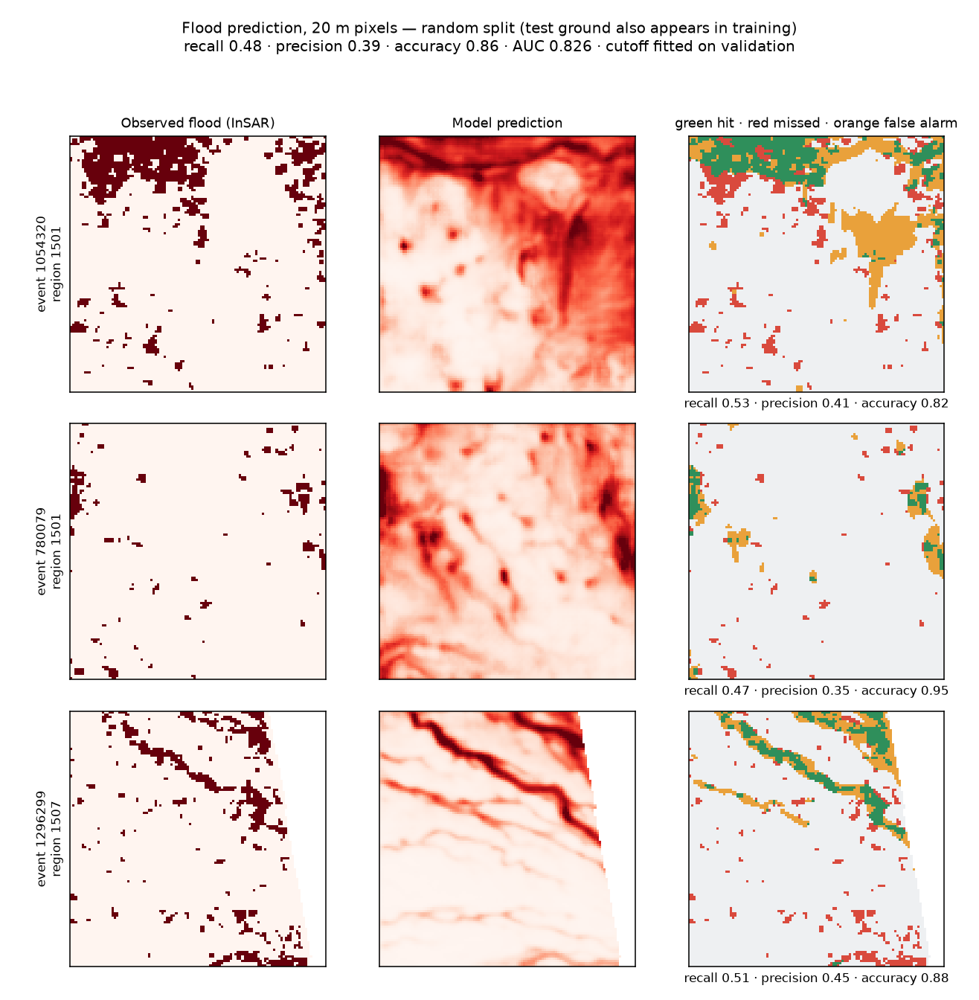

A separately trained model, **identical 30-channel features and the same
`tiles_v4` build as the headline**, evaluated with a random split so test
ground also appears in training. Recall 0.48, precision 0.39, accuracy 0.86,
AUC **0.8264**. Row 3 is the clearest success: the truth is a flood band running
diagonally and the model traces the same band. **This is within-basin
performance, from a different trained checkpoint than the 0.695 headline, and
must not be presented as transfer or as "the same model scored twice."**

### 02. Cross-basin performance at 20 m
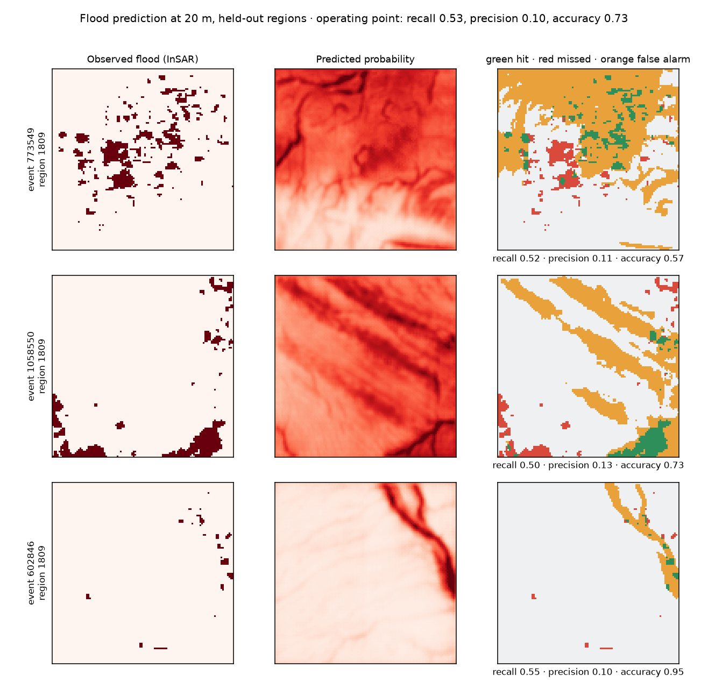

The same model on basins it never saw, at the reported operating point (recall
0.53, precision 0.10, accuracy 0.73). Tiles chosen because their own numbers
match the reported averages. The model points at the right neighbourhoods but
flags roughly ten times more area than actually flooded.

### 03. Cross-basin at 160 m cells
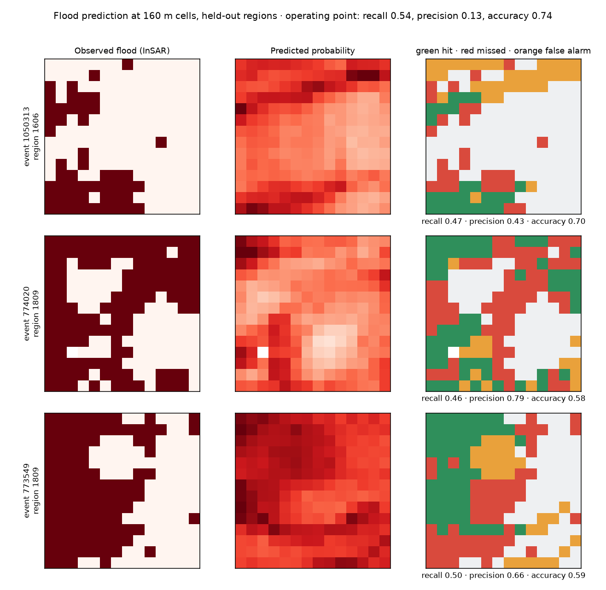

The same predictions grouped into 160 m cells. Per-tile precision 0.43, 0.79,
0.66. The orange false-alarm blanket largely disappears because each cell
averages 64 label pixels.

### 04. What recall 0.80 actually looks like
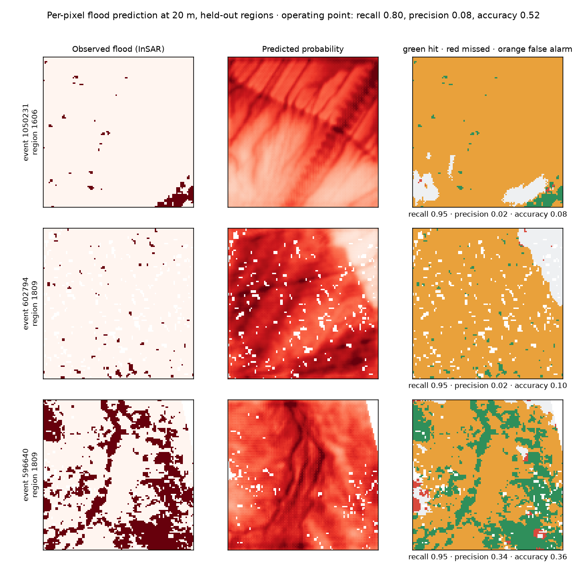

Pushing the cutoff to reach recall 0.80 at 20 m. Almost the entire tile turns
orange. Precision 0.0825, accuracy 0.52. **There is no operating point with high
recall and usable precision at 20 m.**

### 05. Accuracy against spatial precision


How performance changes as the prediction cell grows from 20 m to 2.24 km. Lift
is average precision divided by base rate, which cannot be inflated by making
floods commoner. 160 m is the best compromise.

### 06. Confusion matrix
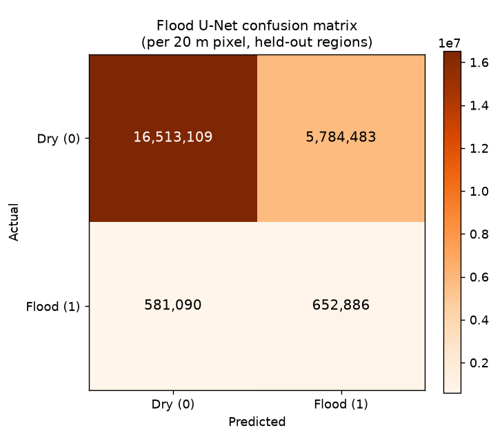

Per 20 m pixel at the F1-optimal cutoff, 23.5 million pixels.

### 07. Best case, with inputs
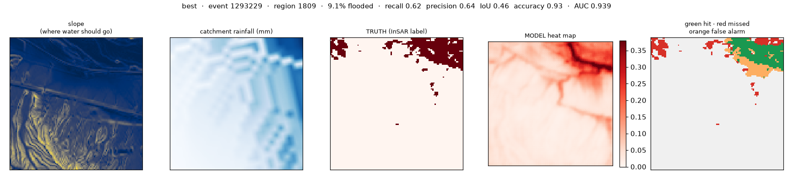

Event 1293229. 9.1% of the tile flooded, which is a realistic fraction.
Recall 0.62, precision 0.64, AUC 0.939. The model traces a drainage line into
the top-right and the truth is there. Legitimate as a best-case example.

### 08. Typical case, with inputs
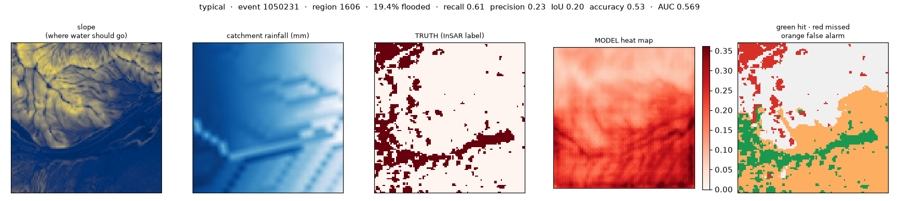

Event 1050231. The model paints the flat valley floor where water collects. The
InSAR truth marks scattered patches up in the terrain where water cannot pool.
**This single figure is the whole argument of the project.**

### 09. Median tiles at 20 m
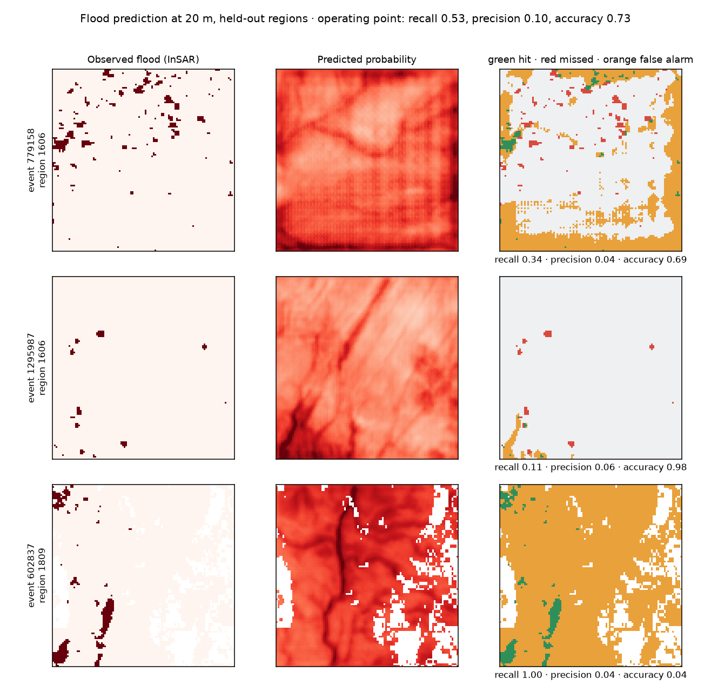

Three tiles at the median of performance. Median per-tile F1 across the test set
is 0.075. Row 3 is instructive: the truth has real coherent structure and the
model's drainage line sits right on it.

### 10. The gated model at 160 m
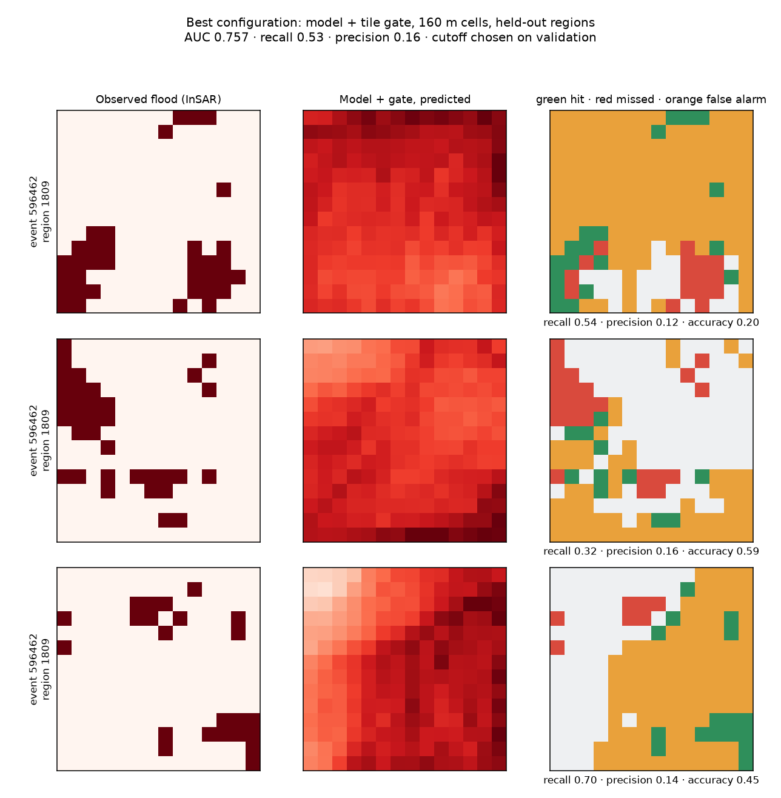

Best configuration by AUC, at a validation-chosen cutoff.

### 13. The spread across 21 configurations
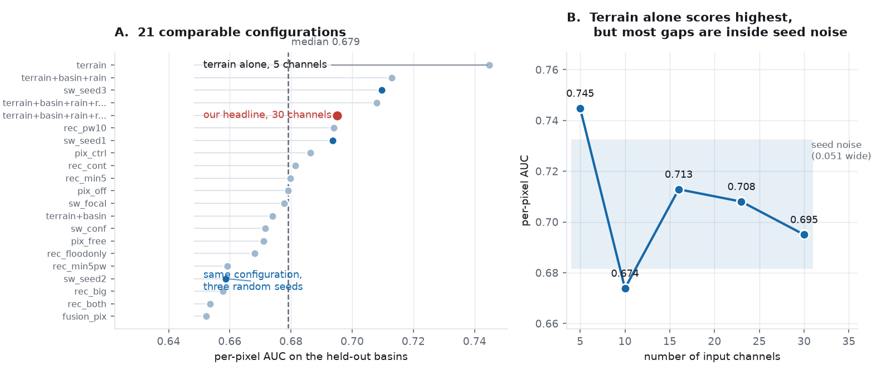

**Left:** every comparable model on the same held-out pixels. Our headline (red)
is near the top of a cloud whose median is 0.679. **Right:** score against
channel count, with the seed-noise band shaded. Four of the five points sit
inside the band, so the differences between feature sets are mostly not
distinguishable. Terrain alone at 0.745 is the one that sits outside it.

### 14. What the choice of split does
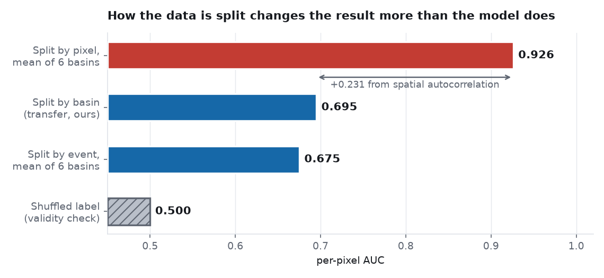

The same data and the same model family, split four ways. Splitting by pixel
inflates the result by **0.231** because a pixel's neighbours end up in
training. The shuffled control at 0.500 confirms the procedure is sound.
**This is the most transferable finding in the project.**

### 11. A quiet control day
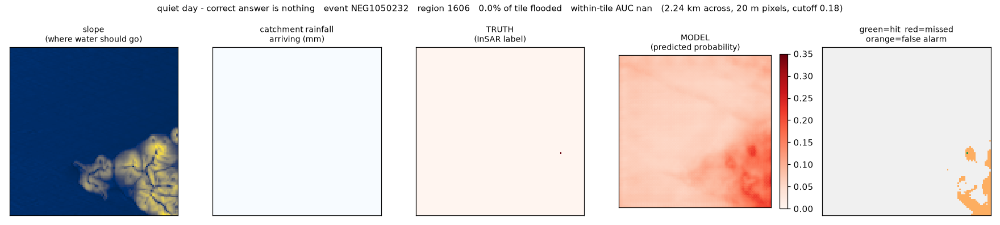

The correct answer is nothing. The model stays quiet.

### 12. Worst case
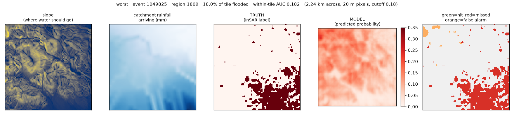

Included deliberately. A page of only good examples is a sales brochure.

---

## 11b. For whoever writes the paper: claims and evidence

Use this as the contract. Each row is a sentence you can write, with what backs
it. **Do not write anything that is not in this table without checking the data
first.**

### Claims that are safe

| Claim | Evidence | File |
|---|---|---|
| Splitting by pixel inflates AUC by 0.231 over splitting by basin | 0.926 vs 0.695, shuffled control 0.500 | `learnable_test.json` |
| Splitting by random tile inflates AUC (matched features/tiles, separate checkpoints) | 0.826 vs 0.695, or 0.830 vs 0.683 as a fully matched same-checkpoint-family pair | `score_extra.json`, see Section 6 caveat |
| The label detects that a flood happened | 86.8% of 174 pairs, p=2.8e-24 | `flood_vs_quiet_result.json` |
| The same model scores higher against optical labels | 0.643 vs 0.751 on identical pixels | `eval_vs_optical.json` |
| InSAR marks ~20x more area as flooded than optical supports | 400,362 vs 19,264 pixels | `eval_vs_optical.json` |
| More multilooking cuts noise 22x but does not improve agreement | 0.0447 to 0.0020; 0.631 to 0.584 | `looks_pilot_result.json` |
| A 3σ criterion fires on 0.00% of pixels at 5 looks | measured on 40 events | `looks_pilot_result.json` |
| Speckle filtering does not clean the label | agreement falls 0.615 to 0.604 | `speckle_test.json` |
| A per-pixel tree performs close to a U-Net with 2.24 km context | 0.680 vs 0.695 | `xgb_vs_unet.json` |
| Removing all routed features costs 0.008 | 0.6954 vs 0.6869 | `xgb_baseline_*.json` |
| A tile-level gate cuts false alarms 76% and adds 0.046 AUC | 2.58M to 631k | `two_stage.json`, `FINAL.json` |
| Cropland tiles show 3x the apparent flood rate | 0.268 vs 0.088, rho +0.368 | `cropland_check.json` |
| Post-flood lidar does not inflate the result | clean 0.738 > dirty 0.676 | `eval_dem_vintage.json` |
| Catchment routed rain beats point rain as a feature | 0.555 vs 0.518 | `baselines_rung10m.json` |
| The model transfers to 5 of 6 basins | 1810 at 0.5135 | `final_numbers.json` |
| Connected-component label cleaning does not improve agreement with optical ground truth, at mild or aggressive settings | 0.6153 -> 0.6106 (mild), and aggressive-alone scores 0.6840 vs 0.7157 mild, same model size | `speckle_test2.json`, Section 8.8 |
| A 3-seed ensemble of the headline model raises AUC by about 0.01 at pixel level, but costs 5-7 points of recall at the fitted operating point | 0.6950 -> 0.7056 AUC; 0.3968 -> 0.3478 recall | `FINAL_ensemble.json`, Section 9.5 |
| Test-time flip augmentation has no effect on this model | AUC identical to 4 decimals | `tta_test.json`, Section 8.9 |

### Claims that must carry a caveat

| Claim | Required caveat |
|---|---|
| "Our model reaches AUC 0.695" | It is the **highest of 21** comparable runs; median 0.679; seed noise 0.051. Report **0.68 ± 0.03** |
| "Precision 0.158 at 160 m" | Precision depends on the base rate; state that 5.24% of pixels flood |
| "Recall 0.533" | Only at the stated cutoff, which is a **flagging rate fitted on validation** |
| "AUC 0.830 on the random split" | Test ground **also appears in training**. Never call this transfer |
| "The full model is our best" | **Terrain alone scores higher on pixel AUC (0.745)**. The full model wins on flood-vs-quiet day (0.798 vs 0.508) |
| "Ensembling improves the model" | True for AUC only. At the reported operating point recall drops 5-7 points; not adopted as the headline (Section 9.5) |
| "The headline scores 0.73 against photo flood-trace labels" | Flood days only; automatic labels not checked by a person; 12 test floods (Section 14.5) |

### Claims that are WITHDRAWN, do not use

| Withdrawn claim | Why |
|---|---|
| "The achievable ceiling is 0.722 and we are within 0.03 of it" | That came from 3 basins. All six give 0.675, below our own result. The test is confounded by training set size |
| "Performance falls monotonically as features are added" | Skipped the 10-channel point (0.674), which breaks the pattern |
| "Recall 0.5396" | That cutoff was chosen on the test set |
| "XGBoost matches the U-Net at 0.6954" | Different pixel sample; fair comparison gives 0.6803 |
| "It transfers in 6 of 6 regions" | That was within-tile AUC; per pixel it is 5 of 6 |
| "More looks will fix the label" | Disproved by the pilot |
| "More aggressive label cleaning gives a bigger improvement" | Aggressive cleaning is worse than mild cleaning at the same model size (0.6840 vs 0.7157); a bigger model only masked the loss, it did not fix it (Section 8.8) |
| "The headline scores 0.93 against independent photo labels" | Inflated by 530 quiet test tiles that are all "no flood"; flood days alone give 0.731 (Section 14.5) |
| "A bigger model helps" | Tested twice, on raw labels (`rec_big`, 0.6578 vs 0.6950) and on cleaned labels (`clean2_region_big` vs `clean2_region`); both times bigger did not net help |

### Suggested framing — REVISED after external review

**An earlier version of this section said "lead with the split experiment" and
called it a general discovery applying "to any pixel-level geospatial
prediction task." That claim is wrong and would be the first thing a careful
reviewer attacked.**

That random splits overstate accuracy on spatially structured data is
established, roughly 20-year-old literature: Roberts et al. 2017 (*Ecography*
40(8):913-929, block CV), Ploton et al. 2020 (*Nat. Commun.* 11:4540, random
splits overstating ecological map accuracy by a wide margin), Meyer & Pebesma
2022 (*Nat. Commun.* 13:2208), and Wadoux et al. 2021 (*Ecol. Model.*
457:109692, the counter-position, arguing spatial CV is not even the right fix).
All four verified as real, correctly described. **Do not present the split
finding as novel in general. It is not.**

**What IS novel, and what to lead with instead:**

1. Nobody has quantified this specific effect for InSAR coherence-based flood
   labelling. That is genuinely new.
2. The event-identity axis (splitting by event, not just by geographic
   distance) is not what the existing spatial-CV literature tests, since tiles
   from one event are not independent even when not geographically close. That
   is an added contribution, not a restatement.
3. The InSAR label ceiling (Section 7) is the stronger, more novel half of this
   paper: the noise floor, the looks trade-off, the 20x over-marking against
   optical evidence, the cropland confound. Nobody has published these for
   flood coherence labelling. Give this more weight than the split experiment.

Cite the four papers above wherever the split effect is discussed. Position
against Wadoux explicitly rather than ignoring the counter-argument, since a
reviewer who knows this literature will raise it regardless.

---

## 12. Literature

### What exists for arid flood prediction

Two camps, and neither is this task.

**Flood susceptibility mapping.** Random Forest, SVM and ensembles over static
terrain and soil, producing "this area is prone to flooding" maps. No
event-specific rainfall, no per-event extent. Reported AUC typically 0.85 to
0.95.
- [Enhancing flash flood susceptibility modeling in arid regions](https://link.springer.com/article/10.1007/s12665-025-12140-4), Environmental Earth Sciences, 2025
- [Machine learning based optimization of flood susceptibility mapping in semi-arid zone](https://applied.dysona.org/machine-learning-based-optimization-of-flood-susceptibility-mapping-in-semi-arid-zone/)

**Runoff forecasting.** CNN-RNN and Neural ODE models predicting discharge at a
gauge over time. A time series, not a map.
- [A Deep Learning Framework for Flash-Flood-Runoff Prediction](https://doi.org/10.3390/w17091283), Water, 2025
- [Near future flash flood prediction in an arid region under climate change](https://www.nature.com/articles/s41598-024-76232-0), Scientific Reports, 2024
- [Machine learning-based hydrological models for flash floods: a systematic review](https://journal.hep.com.cn/scasc/EN/10.1007/s44268-025-00071-9)

**The gap:** per-pixel flood extent for a specific event, in arid basins, from
pre-event data only, labelled by InSAR. Not in that literature.

### Why our numbers look lower than theirs

| | Their task | Ours |
|---|---|---|
| Predicts | is this area flood-prone in general | did this pixel flood on this day |
| Rainfall | usually none | event-specific, catchment routed |
| Split | often random within one region | **six held-out basins** |
| Labels | flood inventory polygons | InSAR, with quantified noise |

Their higher numbers come from an easier question and looser validation. Our
split experiment (Section 6) quantifies exactly how much looser validation is
worth: **0.231 AUC for a pixel split, 0.135 for a random tile split.**

### InSAR coherence for flood mapping

The limitations are discussed everywhere and quantified nowhere. Standard
caveats listed: vegetation decorrelation, revisit time, urban geometry.
- [UN-SPIDER Recommended Practice: flood mapping with Sentinel-1 interferometric coherence](https://un-spider.org/advisory-support/recommended-practices/recommended-practice-flood-mapping-sentinel-1)
- [InSAR Coherence and Intensity Changes Detection](https://www.intechopen.com/chapters/52464), IntechOpen
- [CC-Former: Urban Flood Mapping from InSAR Coherence with Vision Transformer](https://isprs-annals.copernicus.org/articles/X-G-2025/745/2025/isprs-annals-X-G-2025-745-2025.pdf), ISPRS 2025

**Nobody puts a number on the estimator noise floor or the looks trade-off.**
That is what Section 7.5 provides.

### Relation to trial 1

Trial 1 used flood mask class 2 from a published benchmark, a curated label.

| | Trial 1 | Trial 2 |
|---|---|---|
| Label | curated flood mask | InSAR coherence drop |
| Flooded pixels | 9.43% | 5.24% |
| Elevation baseline | **0.7790** | **0.4804** |
| Best model | 0.7779 (tied elevation) | 0.6950 (beat it) |

Trial 1's model **tied** its elevation baseline, meaning machine learning added
nothing there. Ours beats it clearly. But trial 1's absolute numbers are higher
because its label was cleaner. The two are not comparable, and the elevation row
is the cleanest proof of that.

---

## 13. What to do next

### Immediately

**Back this project up.** `trial_2` is not a git repository. 617 events, all
feature stacks, 55 trained models and every result exist on one disk with no
copy.

### For the paper

Frame around the split experiment (Section 6), with the InSAR ceiling as the
case study. Estimated acceptance at IGARSS: 75 to 80% with that framing, 65 to
70% framed as an InSAR ceiling paper, under 10% at a top machine learning venue.

### Research directions that remain

1. **Better labels.** The only lever with real headroom. Hand-annotated or
   optical-derived flood extents on a subset would lift the ceiling itself.
2. **More basins.** Transfer failed in the smallest basin (436 tiles). More
   regions would test whether that is a size effect.
3. **Rainy-day controls.** Our controls are dry days, so "flood day versus quiet
   day" is partly "rainy versus dry". Controls on rainy days with no flood would
   make that question much harder and more useful.

### What not to do

- Do not reprocess at more looks. Measured, does not help (Section 7.5).
- Do not filter the test set. Measured, makes the model worse while the
  headline improves (Section 8.5).
- Do not report a random split as transfer performance (Section 6).
- Do not tune the cutoff on the test set.
- Do not apply connected-component "denoising" to the label. Tested at mild
  and aggressive settings against independent optical ground truth; it does
  not improve agreement with reality at either setting (Section 8.8).
- Do not assume ensembling is a free win. It raises AUC a little but costs
  real recall at the fitted operating point (Section 9.5). Check both, not
  just AUC, before adopting.

---

## 14. Photo flood-trace labels (September 2026)

Direction 1 of Section 13, tried at full scale. The aim was a label clean
enough for high recall **and** high precision: no gaps inside flood paths, no
noise dots, floods skipped rather than kept when their marks are not clean.

### 14.1 The idea

A desert flash flood drains in hours, but it leaves fresh pale sand and scour
along the washes for weeks. So instead of looking for water, compare the last
clear Sentinel-2 photo before the flood with the first clear one after it, and
mark ground that became paler. Only photos and radar are used to build the
label. Terrain, basin and land cover are never used, because the model gets
them as inputs and a label built from them would leak (the Section 8.3 lesson).

The same idea was shown for the 13-14 August 2021 Gila Bend flood with daily
3 m PlanetScope images by Wang and Vivoni (Remote Sensing 14:4218, 2022). That
is event 983830 in our dataset ("Painted Rock"), our main test flood.

### 14.2 Pipeline

| Step | Script | Output |
|---|---|---|
| Download, mark, save every flood | `phase7/mark_floods_v3.py` | `data/trace_v3/all/` |
| Apply rules offline, picture sheets | `phase7/apply_rules.py` | `data/trace_v3/labels/<rules>/` |
| Training tiles | `phase7/build_trace_tiles.py` | `data/tiles_trace_<rules>/` |
| Train and score | `phase7/run_final.sh`, `phase7/run_finetune.sh` | `data/*_final.json`, `data/compare_*.json` |
| Human check page | `phase7/make_check_page.py` | `handoff/flood_check/` |
| PlanetScope search and order (untested, no key yet) | `phase7/planet_fetch.py` | `data/planet/` |

Rule settings live in `data/trace_v3/rules_v1.json` (strict) and
`data/trace_v3/candidates_v1.json` (loose radar limit). Every rule and the
flood that motivated it is written in the docstrings of the two scripts.

### 14.3 Problems found on the way (all fixed, all small samples first)

| Problem | Found on | Fix |
|---|---|---|
| Light and haze differences painted half a square red | 10-flood pilot | reflectance, robust light matching, noise level from a no-flood control pair |
| Cloud edges marked as flood | pilot, 20-flood stage | cloud ring, no marks within 300 m of clouds, skip if under 90% clear |
| Farms marked as flood | pilot | remove ground that got greener or was green (NDVI) |
| "Less green" rule deleted real scour at Painted Rock | pilot try 2 | removed; only greener ground is removed |
| 200 m ring around false single-cell "clouds" rejected clear photos | 20-flood stage | ring only around cloud groups of 1 ha or more |
| Duplicate photos: code picked a paid (unreadable) copy | 20-flood stage | free copies only |
| 2017-2018 cloud mask calls a fifth of bright desert "unclassified" | 20-flood stage | unclassified counts as clear |
| Catalogue offset of -0.1 is wrong for the 05.00 copies (pixel values match the 03.01 copies) | reflectance check | offset ignored, dark-object subtraction per band |
| Link to photo store 50 KB/s to 1 MB/s, one flood at 10 m over 15 min | Painted Rock test | everything read at 20 m from built-in overviews |
| Shape rule based on box fill called Painted Rock "blocky" | rules test | outline compactness instead |

### 14.4 How many floods survive

| Stage | Floods |
|---|---|
| Floods with training tiles | 567 |
| No usable photos (2015-2016 have none in the free archive; clouds) | 125 |
| Clear photos, marks computed | 442 |
| Pass the loose rules (`candidates_v1`) | 63 (655 tiles) |
| Pass the strict rules (`rules_v1`) | 28 (275 tiles) |

Picture review of the kept floods: most false keeps are changes on empty lots
at the edge of towns. Two photo-only measures to catch them (local contrast on
the marks, contrast around the marks) did not separate towns from real floods
and are not used. None of the 63 or 28 has been checked by a person yet.

### 14.5 Results

All on the held-out regions 1606 and 1809, answer key = the strict photo labels
(127 flood-day tiles, 530 quiet tiles, 1.18% of pixels flooded).
File: `data/compare_ft_rules_v1.json`.

| Model | Trained on | AUC, all test tiles | AUC, flood days only | Precision at recall 0.25 | Precision at recall 0.50 |
|---|---|---|---|---|---|
| Headline | radar label, 5,887 tiles | 0.927 | **0.731** | 0.111 | **0.111** |
| Photo only | strict photo label, 275 tiles | 0.834 | 0.699 | 0.084 | 0.073 |
| Fine-tuned | headline, then strict photo label (lr 5e-5) | 0.880 | 0.697 | **0.125** | 0.082 |

The loose version (63 floods) behaves like the strict one: 0.816 AUC on the
strict key, precision 0.071 at its own cutoff (`data/compare_all_on_rules_v1.json`).
Both photo-only models lose to the free elevation rule inside tiles (0.609 and
0.603 against 0.654 and 0.684).

### 14.6 What it means

1. **275 clean tiles do not beat 5,887 noisy ones.** Same lesson as the earlier
   direct-photo experiment: at this size, amount of data matters more than
   label cleanliness.
2. **Starting from the headline and training a little on clean floods helps
   the most confident predictions** (precision 0.125 against 0.111 at recall
   0.25) but not the wider sweep (0.082 against 0.111 at recall 0.50).
3. **The headline model holds up against an independent answer key.** On flood
   days alone it scores 0.731, close to its 0.751 against the older optical
   label (Section 11b). The 0.927 over all test tiles is inflated by quiet
   days, which are all "no flood" and easy. **Report 0.73, not 0.93.**

### 14.7 Claims

Safe:
- The photo-trace method recovers the Painted Rock flood traces, and the radar
  agrees with them (extra coherence loss +0.21 inside the marks).
- Only 28 to 63 of 442 floods with clear Sentinel-2 photos give usable marks.
- Fine-tuning the headline on strict photo labels raises precision at recall
  0.25 from 0.111 to 0.125 on the strict photo answer key.

Must carry a caveat:
- "The headline scores 0.73 against photo labels": the labels are automatic,
  not checked by a person; 127 flood-day tiles from 12 floods.
- Any number on the photo answer key: it is the same label family the photo
  models were trained on (different regions), so it favours them slightly.

Do not use:
- "The headline scores 0.93 against independent labels." Inflated by quiet days.

### 14.8 Checked by eye

Adham asked Claude to do the check with one rule: no noise, when in doubt it
is Wrong. All 63 candidates were looked at, 13 zoomed in. Answers with a reason
each are in the check page database (collection `checks_v1`) and
`data/trace_v3/checks_v1.json`.

| Verdict | Floods |
|---|---|
| Right: a new deposit visible in the after photo, and the red follows it | 3 |
| Not sure: flood-like pattern, but no visible change between the photos | 11 |
| Wrong: towns, fields, rock, roads, cloud edges, or no change | 49 |

The 3 are 779149 (2018, region 1503), 1142175 (2023, 1809) and 1293229 (2025,
1809). Their labels were cleaned by hand to the visible deposit (pieces outside
it and thin road lines removed): `data/trace_v3/labels/checked_v1/`, picture
`data/trace_v3/review/checked_v1_cleanup.jpg`. One is in a training region, so
they cannot train a model; the two in the test regions (24 flood tiles) are a
trusted test. File: `data/compare_on_checked_v1.json`. Validation holds no
checked flood, so only cutoff-free numbers are meaningful:

| Model | AUC, flood days only | Precision at recall 0.25 | Precision at recall 0.50 |
|---|---|---|---|
| Headline | 0.647 | 0.156 | 0.137 |
| Photo only (strict) | 0.679 | 0.196 | 0.127 |
| Fine-tuned | 0.668 | **0.209** | **0.175** |

Two floods only: a direction, not a result. It agrees with 14.5 that starting
from the headline and fine-tuning on clean floods helps precision.

**What this says about Sentinel-2:** of 567 floods, 3 give marks a careful eye
accepts. The limit is the photos (revisit and 20 m detail), not the rules.

### 14.9 Labels or inputs? Half-split test on clean floods

`phase7/half_split_test.py`, output `data/half_split_test.json`. Train on one
half of a clean flood's square, test on the other half, 1 km gap, four
directions, per-pixel gradient-boosted trees on the same 30 inputs. Decision
lines were written before the run: at least 0.85 means the inputs are fine,
0.70 or less means the inputs are the bottleneck.

| Flood | Clean photo label | Radar label, same pixels | Shuffled label | Elevation rule |
|---|---|---|---|---|
| 983830 Painted Rock | 0.746, 0.762, 0.780, 0.846 (mean **0.784**) | 0.707, 0.765, 0.654, 0.764 | 0.492, 0.473, 0.645, 0.518 | 0.852, 0.607, 0.714, 0.414 |
| 1142175 fans | 0.608, 0.620, 0.629, 0.641 (mean **0.625**) | 0.702, 0.817, 0.436, 0.521 | 0.460, 0.650, 0.471, 0.549 | 0.615, 0.481, 0.617, 0.473 |

1293229 and 779149 could not be scored: after cleaning, their flood lies in
one half only.

**Reading:** neither flood reaches 0.85. The fan flood sits at 0.62, inside the
range of the shuffled control (up to 0.65), so the inputs barely describe where
it went even with a clean label and no transfer. Painted Rock reaches 0.78, in
between. The clean label beats the radar label on Painted Rock by about 0.06.
**The inputs are a real bottleneck, not only the labels.** Caveats: two floods;
the shuffled control reaching 0.645 shows single splits move by about 0.15;
rain is nearly uniform inside one square, so this test probes terrain, soil and
land cover, not rain.

**Sharp terrain does not change it** (`data/half_split_test_allrungs.json`).
Same test with terrain at 1, 2, 5, 10 and 30 m stacked: Painted Rock 0.784 to
0.786, the fan flood 0.625 to 0.633. The lidar layers are summaries on the
20 m grid (mean, minimum, micro-relief, roughness, slope), so this rules out
more terrain statistics per cell, not every use of 1 m detail.

A caveat on what the clean label measures: it marks fresh sediment and scour
that stayed visible, not all ground the water covered. Where sediment settles
may be harder to predict from static inputs than where water spreads.

**Light rule bug, fixed.** The old rule (whole-square brightness ratio) skipped
Painted Rock, because the flood itself brightened a fifth of the square
(ratio 1.198). The new rule uses the slope of the robust light fit on unchanged
ground, kept if 0.85 to 1.25 (wet-ground floods 1295895 and 782683 have slopes
0.76 and 0.73; Painted Rock 1.07). Rules files `rules_v2.json`,
`candidates_v2.json`. Candidates went from 63 to 69: 10 new, 4 lost. The 4
lost had all been checked Wrong. Of the 10 new, checked by eye: Painted Rock
Right, 4 Not sure (visible change in two, but marks cover only part of it or
spill onto unchanged ground), 5 Wrong (cloud shadows, haze, no change).
Answers: `data/trace_v3/checks_v2.json`. Clean set now 4 floods:
`data/trace_v3/labels/checked_v2/` (regions 1503, 1507, 1809, 1809).

### 14.10 The area question, and why its high score is not usable yet

`phase7/area_day_test.py`, output `data/area_day_test.json`. Will a flash flood
be reported in this 10 km square today? Positives are flood squares on their
NOAA report day, negatives the same places on quiet days (same season, no
report in the basin within 14 days). Test regions 1606 and 1809: 137 flood
squares, 52 quiet squares. Cutoffs chosen on validation.

| Score | AUC | Recall | False alarm rate | Precision at 50/50 |
|---|---|---|---|---|
| Trees on square summaries | 0.981 | 0.891 | 0.038 | 0.959 |
| **Rain alone (24 h, square mean)** | **0.943** | **0.869** | **0.038** | **0.958** |
| Headline U-Net, best tile per square | 0.837 | 0.708 | 0.231 | 0.754 |
| Shuffled-label trees | 0.588 | 0.431 | 0.288 | 0.599 |

**Not usable as a result.** Rain alone scores almost as high as the model,
because 51 of the 52 quiet test days had under 5 mm of rain. The test mostly
asks "did it rain today?", which any reviewer would reject. The quiet days were
chosen for no flood report, not for rain (Section 13 already listed rainy-day
controls as missing). The honest version needs quiet days with heavy rain and
no flood; only then does a high score mean the model predicts floods.

### 14.11 Next

1. Keep the headline as the reported model; add the fine-tuning result with the
   caveats above.
2. PlanetScope: Education and Research application submitted 2026-09-14 (review
   up to 3 weeks). When approved: search is free, test 3 floods (Painted Rock
   first) against Sentinel-2 with `phase7/planet_fetch.py`, then about 10 to 15
   floods per month within the 3,000 km2 quota.

---

*Every number in this document was produced by a named script in this repository
and can be traced to a JSON file in `data/`. Nothing is quoted from memory.*
